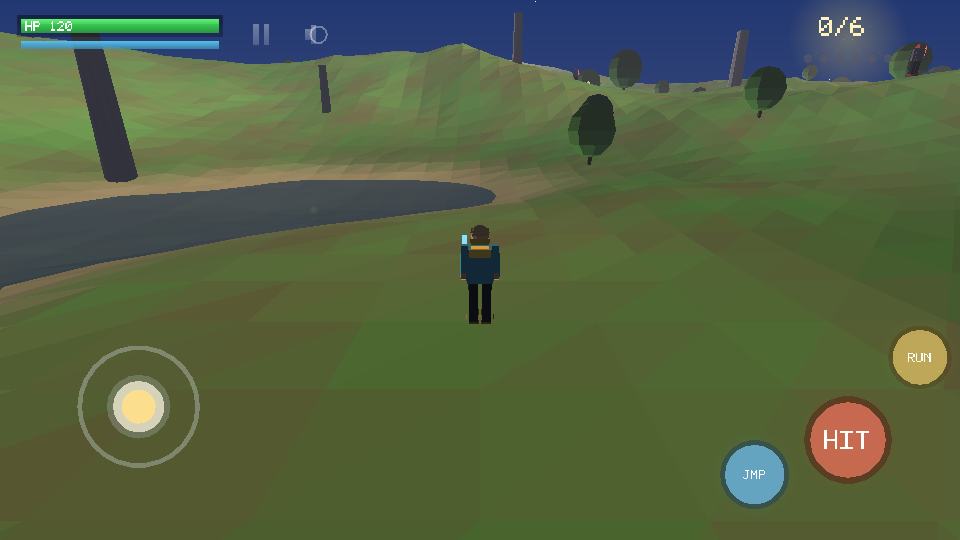
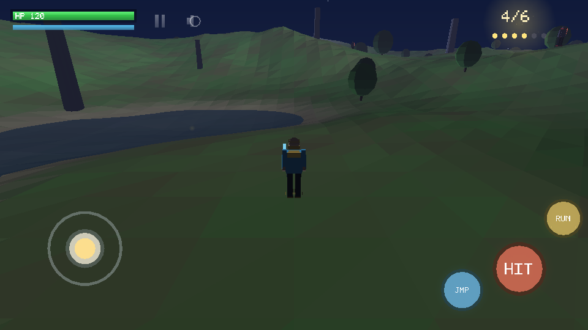
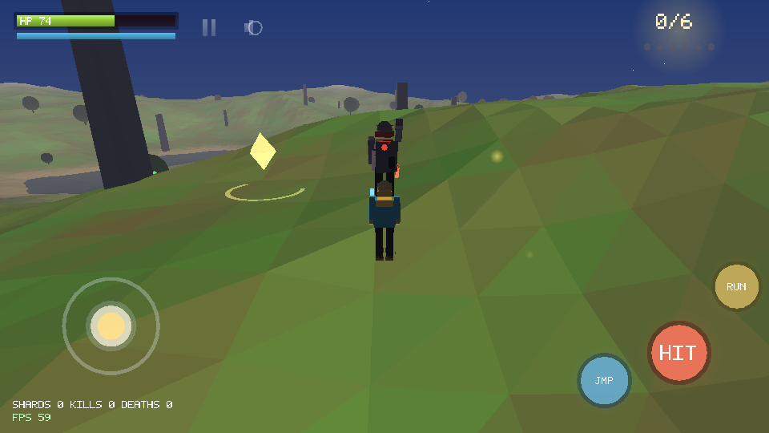
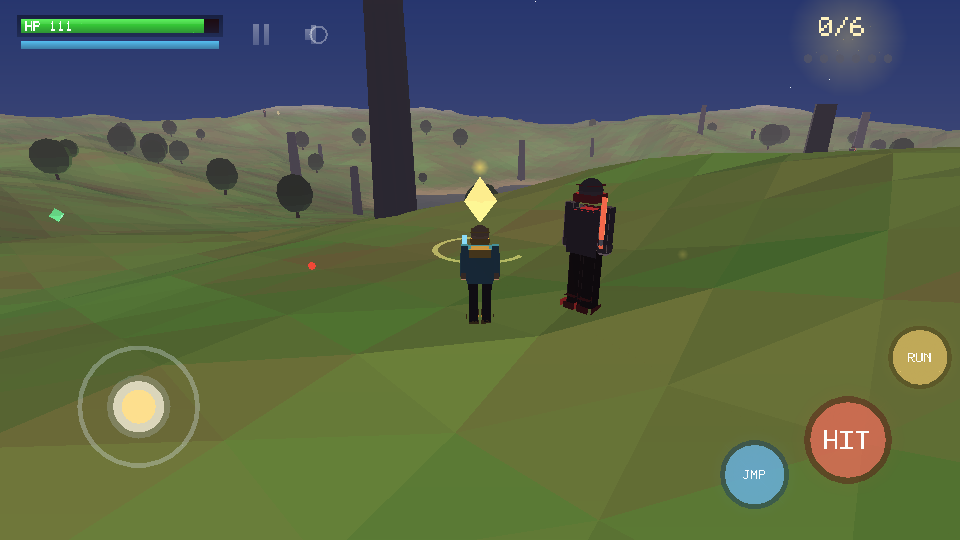

# Last Star

A complete, playable Android 3D action game — **built and signed in this
repository**, no Unity, no Gradle, no Android Studio required.

[](apk/last-star-1.0.0.apk)
[-blue)]()
[]()
[]()
[](LICENSE)



---

## Install and play (2 minutes)

1. Copy **`apk/last-star-1.0.0.apk`** to your phone (USB, Google Drive, or
   download it straight from this repository on the phone).
2. Open it. Android will warn that the app is from an unknown source:
   tap **Settings → Allow from this source**, then **Install**.
3. Launch **Last Star**. Hold the phone in landscape.

Works on **every Android device since Android 5.0 (API 21)** — 32-bit, 64-bit,
ARM and x86. No internet permission, no ads, no analytics, ~250 KiB.

### Controls

| Control | Action |
|---|---|
| Left thumb, anywhere on the left half | Move (analogue; the stick appears under your thumb) |
| Drag on the right half | Look / orbit the camera |
| **HIT** | Melee attack (3-hit combo, 110° arc) |
| **JMP** | Jump |
| **RUN** | Sprint (drains the blue stamina bar) |
| ❙❙ / 🔊 icons, top left | Pause-resume state / mute (both remembered) |

### The game

Six star shards have fallen across a fragmented landscape guarded by **Wardens**.
Collect all six before they overwhelm you. Every shard you recover pushes the
world from dusk into night — sky, fog, sun and ambient light all shift as you
progress — and every second shard heals you and raises your maximum health.
Clear all six to restore the sky, then begin the next, harder night.

* Procedurally generated 220 m × 220 m island: rolling hills, ridged mountains, a
  lake with sand shoreline, snow on the peaks, scattered trees and monoliths
* Six shards, five+ Wardens (more each level) with telegraph → swing → recover
  melee AI, aggro, leashing, stagger and health regeneration
* Third-person orbit camera with terrain-aware pull-in, camera-relative
  movement, jump/gravity, slope and water penalties
* Fully procedural characters animated by posing a procedural rig — walk, run,
  jump, attack swing, cape flare, hit flash
* Procedurally synthesised sound effects (no audio files in the APK)
* HUD: health/stamina, shard tracker, off-screen shard and threat indicators,
  damage and pickup flashes, intro / victory / defeat screens
* Preferences and best-run records persist across launches





---

## The three upstream repositories

All three are copied into [`upstream/`](upstream/README.md), with their licences
intact.

| Repository | Licence | Status of the copy |
|---|---|---|
| [AnyRPG/AnyRPGCore](https://github.com/AnyRPG/AnyRPGCore) | MIT | **All 1,094 C# source files**, all shaders / Shader Graph / input actions, `Packages/` + `ProjectSettings/` (Unity 6000.3.10f1), plus a `FILE_INDEX.csv` listing **all 22,914 upstream files** with sizes |
| [Jay22K/unity-Third-person-controller-android](https://github.com/Jay22K/unity-Third-person-controller-android) | **GPL-3.0** | **Complete — 7 of 7 files**, including `Third_person_controller.unitypackage` (1,245 asset entries) |
| [nikunjsingh93/Android_Unity3D_OpenWorld](https://github.com/nikunjsingh93/Android_Unity3D_OpenWorld) | none declared | **Complete — all 32 files**, including the author's prebuilt `car and fps.apk` |

Two notes worth reading:

* **AnyRPGCore is 1.2 GB** (803 MB of it FBX/PSD/WAV art and baked scenes,
  22,916 files). GitHub rejects files over 100 MB and a full media dump does not
  belong in this repository, so the binary media is externalised — one
  `git clone https://github.com/AnyRPG/AnyRPGCore.git` restores it into the same
  folder structure. `upstream/AnyRPGCore/FILE_INDEX.csv` documents every file.
* **Why Last Star is not a Unity build.** All three projects are Unity projects,
  and Unity Editor (a multi-GB, licence-gated download) is not available in the
  environment that produced this repository, so a Unity APK cannot be built
  here. Last Star is an original game written directly against OpenGL ES 2.0 in
  Java: it builds with a JDK today, and ships as the installable APK above. The
  Unity projects are intact in `upstream/` for when you have Unity installed
  (AnyRPGCore needs **6000.3.10f1**, OpenWorld needs **5.6**).

The GPL-3.0 third-person controller package is deliberately **not** linked into
the APK, which keeps Last Star's EPL-2.0 licensing clean.

---

## How the APK is built

The build machine had **no Unity, no Android SDK, no Gradle and no JDK**. The
pipeline was assembled from what was reachable and is fully reproducible:

```
 resources ─ aapt2 compile/link ─┐
 Java sources ─ ecj ────────────┼─ d8 ─ zipalign.py ─ apksigner ─ last-star.apk
 (android.jar API 34)          ─┘        (v1+v2+v3 signatures)
```

| Stage | Tool | Source |
|---|---|---|
| Resource compile & link | `aapt2` 2.20 (Linux x64) | `aaptjs3` npm package |
| Java compilation (Java 8 target) | `ecj` 3.45 | `@drxiaozhi/minapk` npm package |
| Dexing to `classes.dex` | `d8` 8.2.2 | same package |
| Platform stubs | `android.jar` (API 34) | same package |
| Java runtime | Temurin JDK 25 | `jdk4py` on PyPI |
| Signing | `apksigner` 0.9 | `@drxiaozhi/minapk` |
| Alignment | `tools/zipalign.py` | written for this repository |

```bash
tools/fetch_toolchain.sh && source tools/.toolchain/env.sh
tools/build_apk.sh
# BUILD OK
#   apk      : apk/last-star-1.0.0.apk
#   size     : 249 KiB
#   minSdk   : 21
```

Full details, flags and troubleshooting: [`docs/BUILD.md`](docs/BUILD.md).

The signing keystore is generated on first build
(`keystore/laststar-release.jks`, alias `laststar`, password `laststar`), so
installing a newer build over an older one keeps the app's saved data. It is a
self-signed hobby key, not a Play Store identity.

## Verifying it works

There is no GPU, emulator or phone in this environment, so correctness is proven
two ways — `tools/run_tests.sh` runs both:

1. **13,506 headless assertions** (`desktop/HeadlessTest.java`) drive the real
   simulation: terrain sampling, camera matrices and clamping, movement and
   stamina, melee arcs, enemy AI states, pickups, death/respawn, victory and
   restart, mesh and index validity, the HUD font atlas, plus a bot that plays a
   complete six-shard run at 60 Hz. Result: **PASS**, slowest simulated frame
   0.5 ms.
2. **A software rasteriser** (`desktop/Raster.java`) renders real frames from the
   *shipping* terrain generator, character rig, camera and HUD code — that is
   where `docs/screenshots/` comes from. It found two genuine bugs during
   development (inverted camera pitch, sign-flipped strafe vector) and one more
   in review (particle uniforms written to the wrong GL program).

Every build also self-checks the artefact: `apksigner verify` reports **v1 + v2 +
v3 all true**, and `resources.arsc` is confirmed STORED and 4-byte aligned as
Android 11+ requires.

## Repository layout

```
apk/                          ← the installable artefact
app/src/main/java/            ← the game (30 classes, ~5,400 lines)
  com/laststar/game/
    core/     Vec3, Mat4, Noise, Terrain, Camera     (pure maths / world)
    world/    World, Player, Enemy, Shard, Pickup…   (pure simulation)
    gl/       SceneRenderer, Geometry, Shaders, Mesh (OpenGL ES 2.0)
    art/      HumanoidRig (procedural characters)
    ui/       Hud, UiBatch, UiRenderer, TouchControls, Font
    audio/    SoundFx (procedural PCM synthesis)
    Prefs.java                                        (settings, best runs)
desktop/                      ← headless tests + software renderer
tools/                        ← build, test, toolchain fetch, zipalign, icons
docs/                         ← BUILD.md, screenshots, icon
upstream/                     ← the three repositories + their licences
```

## Licence

The Last Star game (this repository's `app/`, `desktop/`, `tools/`, `docs/`) is
released under the repository's existing **Eclipse Public License 2.0** — see
[`LICENSE`](LICENSE). The `upstream/` folder is *not* covered by that licence and
keeps the upstream terms described in [`upstream/README.md`](upstream/README.md).
