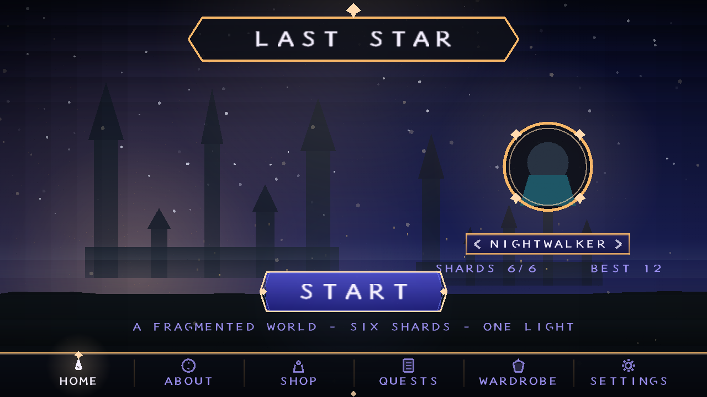
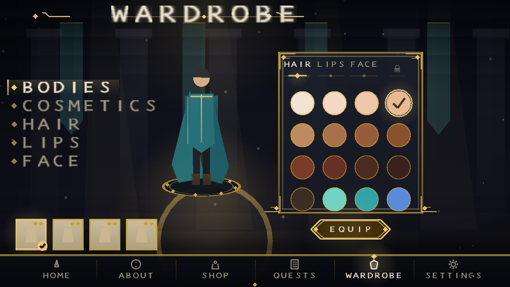
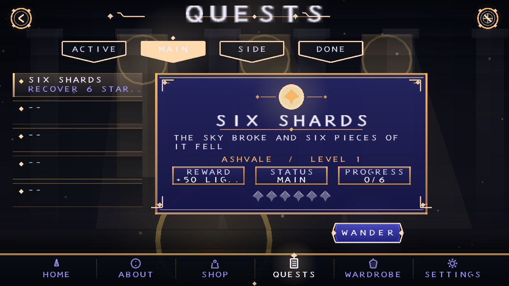
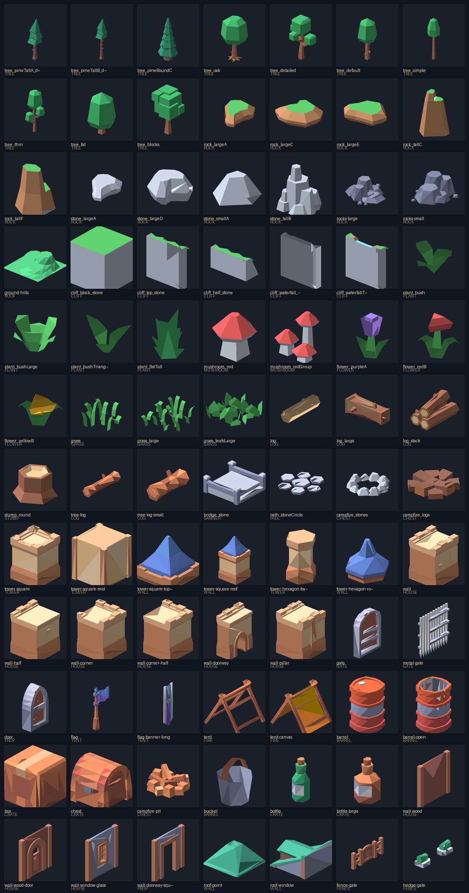

# Last Star

A complete, playable Android 3D action game — **built and signed in this
repository**, no Unity, no Gradle, no Android Studio required.

[](apk/last-star-1.0.0.apk)
[-blue)]()
[]()
[]()
[](LICENSE)


---

## Install and play (2 minutes)

**Download:** [**last-star-1.0.0.apk**](https://github.com/Endiq-jar/Last-Star/raw/arena/b1ab2e08-last-star/apk/last-star-1.0.0.apk)
· in the repo: [`apk/last-star-1.0.0.apk`](apk/last-star-1.0.0.apk)
· release notes: [v1.0.0](https://github.com/Endiq-jar/Last-Star/releases/tag/v1.0.0)

1. Get **`apk/last-star-1.0.0.apk`** onto your phone (open the link above on the
   phone, or copy the file over USB / Google Drive).
2. Open it. Android will warn that the app is from an unknown source:
   tap **Settings → Allow from this source**, then **Install**.
3. Launch **Last Star**. Hold the phone in landscape.

Works on **every Android device since Android 5.0 (API 21)** — 32-bit, 64-bit,
ARM and x86. No permissions at all: no internet, no ads, no analytics, ~462 KiB.
Signed with APK schemes v1 + v2 + v3
(SHA-256 `656a3bb75cc3628a4644ce831c426ba74b99eb4fb1f4acd3b8614d61af67ba7b`).

### Controls

| Control | Action |
|---|---|
| Left thumb, anywhere on the left half | Move (analogue; the stick appears under your thumb) |
| Drag on the right half | Look / orbit the camera |
| **HIT** | Melee attack (3-hit combo, 110° arc) |
| **JMP** | Jump |
| **RUN** | Sprint (drains the blue stamina bar) |
| ❙❙ / 🔊 icons, top left | Open the menus / mute (the ❙❙ button opens Settings) |
| Bottom tab bar | Home · About · Shop · Quests · Wardrobe · Settings |

### The interface

The game opens on a painted title screen and the whole shell is a hand-built
fantasy UI: midnight-navy vistas, ivory letter-spaced serif capitals, gold
filigree frames with corner scrollwork, diamond tabs, parchment cards and teal
"on" accents. Six pages, all reachable from the bottom bar:

| Page | What it does |
|---|---|
| **Home** | Title plate, hero medallion, `‹ NAME ›` selector, **START** |
| **About** | Illuminated scroll: the story, the task, the controls, build info |
| **Shop** | Merchant's alcove, purse, eight trinket cards with prices; tap to inspect, PURCHASE to confirm |
| **Quests** | Completed / Side / Main / Serve Quests tabs, a ribbon list and a parchment detail card with reward, status and shard pips |
| **Wardrobe** | Category rail, the character standing on a lit dais, four body tiles, a 4×4 skin-and-eye swatch grid, HAIR / LIPS / FACE chips and **EQUIP** |
| **Settings** | Five roman-numeral set tabs, an in-panel vertical volume slider, AUDIO / HAPTICS / CAMERA SHAKE toggles, a difficulty dropdown and **RESET** |

Everything on those pages is live: the difficulty changes your starting health
(140 / 100 / 80), the wardrobe swatch recolours the character's head in-game, and
the volume, toggles, name and page choices persist across launches.





**No UI toolkit, no fonts, no drawables.** Every screen is batched triangles
(`UiBatch`) drawn in one GL call. The typeface is `VectorFont`: a Trajan-style
serif described as strokes in source, scan-converted at start-up into a signed
distance-field atlas (320×322 bytes, ~20 ms on a desktop JVM), so 8-pixel
small-caps stay crisp at any scale without shipping a TTF. Backdrops
(`Backdrop`) are painted procedurally — layered gradients, ridgelines, light
shafts, bokeh and drifting motes.

### The game

Six star shards have fallen across a fragmented landscape guarded by **Wardens**.
Collect all six before they overwhelm you. Every shard you recover pushes the
world from dusk into night — sky, fog, sun and ambient light all shift as you
progress — and every second shard heals you and raises your maximum health.
Clear all six to restore the sky, then begin the next, harder night.

* Procedurally generated 220 m × 220 m island ringed by foothills, with a
  **snow-capped mountain range** on the horizon (a separate 56-peak mesh that
  follows the camera, so the skyline is never empty), a lake with sand
  shoreline — dressed with **84 imported CC0 models**, including **14 rock
  spires built from imported cliff blocks** standing inside the map itself (7,000+ trees, rocks, bushes, grass and flowers; cliff ridges; a
  castle gatehouse, a courtyard with towers, a camp and a watchtower), distance
  culled per model so the draw count stays low while the map looks full
* Six shards, five+ Wardens (more each level) with telegraph → swing → recover
  melee AI, aggro, leashing, stagger and health regeneration
* Third-person orbit camera with terrain-aware pull-in, camera-relative
  movement, jump/gravity, slope and water penalties
* Fully procedural characters animated by posing a procedural rig — walk, run,
  jump, attack swing, cape flare, hit flash
* Procedurally synthesised sound effects (no audio files in the APK)
* HUD: health/stamina, shard tracker, off-screen shard and threat indicators,
  damage and pickup flashes, intro / victory / defeat screens
* Preferences and best-run records persist across launches


---

## The imported model set

The assets that came with this pass are **CC0 Kenney kits** — Nature, Fantasy
Town, Castle and Survival — pulled from the CC0 mirror
[`shorepine/kenney`](https://github.com/shorepine/kenney), baked into one asset
and used *everywhere* in the world, not in a single showcase corner.



`tools/fetch_models.sh` downloads the source glTF files, `tools/bake_models.py`
flattens, re-tints, scales and packs them, and `ModelLibrary` / `PropPlanner`
place them:

| Landmark | What it is |
|---|---|
| **Castle gate** | Two towers with roofs and banners, a gatehouse arch and a curtain wall on the highest ridge |
| **Courtyard** | A twelve-segment ring wall, hex towers, a path circle, a tent, a fire, barrels and a chest |
| **Camp** | Tents, fire, log seats, a barrel, a crate, a chest, a bucket and a fence gate |
| **Watchtower** | A tower, roof, banner and doorway, with a half-collapsed ruin beside it |

Everything else is scattered by role: 380 trees, 210 rocks, 760 plants, 2,200
grass tufts, 900 flowers, 260 mushrooms, 110 logs, 55 stumps, 150 cliff blocks
and 24 hills, on a grid that keeps landmark clearings and the player's path open.
Per-role draw distances (grass 30 m … cliffs 200 m) keep the frame cheap: the
world is dressed with thousands of props, but only what is near you is drawn.

Colour and scale are normalised at bake time so the imported art reads as part
of the same Genshin-like palette as the procedural terrain. Full attribution and
the licence notes are in [`CREDITS.md`](CREDITS.md).

### Continuous integration

[`.github/workflows/android-ci.yml`](.github/workflows/android-ci.yml) runs on
**every push to every branch** and on `workflow_dispatch`: it fetches the
toolchain from npm and PyPI, compiles all sources, runs the 13,573 headless
checks, builds and signs the APK, asserts `assets/models/world.bin` is packaged,
and uploads the APK as a build artefact.

---

## The three upstream repositories

All three are copied into [`upstream/`](upstream/README.md), with their licences
intact.

| Repository | Licence | Status of the copy |
|---|---|---|
| [AnyRPG/AnyRPGCore](https://github.com/AnyRPG/AnyRPGCore) | MIT | **All 1,094 C# source files**, all shaders / Shader Graph / input actions, `Packages/` + `ProjectSettings/` (Unity 6000.3.10f1), plus a `FILE_INDEX.csv` listing **all 22,914 upstream files** with sizes |
| [Jay22K/unity-Third-person-controller-android](https://github.com/Jay22K/unity-Third-person-controller-android) | **GPL-3.0** | **Complete — 7 of 7 files**, including `Third_person_controller.unitypackage` (1,245 asset entries) |
| [nikunjsingh93/Android_Unity3D_OpenWorld](https://github.com/nikunjsingh93/Android_Unity3D_OpenWorld) | none declared | **Complete — all 32 files**, including the author's prebuilt `car and fps.apk` |

Two notes worth reading:

* **AnyRPGCore is 1.2 GB** (803 MB of it FBX/PSD/WAV art and baked scenes,
  22,916 files). GitHub rejects files over 100 MB and a full media dump does not
  belong in this repository, so the binary media is externalised — one
  `git clone https://github.com/AnyRPG/AnyRPGCore.git` restores it into the same
  folder structure. `upstream/AnyRPGCore/FILE_INDEX.csv` documents every file.
* **Why Last Star is not a Unity build.** All three projects are Unity projects,
  and Unity Editor (a multi-GB, licence-gated download) is not available in the
  environment that produced this repository, so a Unity APK cannot be built
  here. Last Star is an original game written directly against OpenGL ES 2.0 in
  Java: it builds with a JDK today, and ships as the installable APK above. The
  Unity projects are intact in `upstream/` for when you have Unity installed
  (AnyRPGCore needs **6000.3.10f1**, OpenWorld needs **5.6**).

The GPL-3.0 third-person controller package is deliberately **not** linked into
the APK, which keeps Last Star's EPL-2.0 licensing clean.

---

## How the APK is built

The build machine had **no Unity, no Android SDK, no Gradle and no JDK**. The
pipeline was assembled from what was reachable and is fully reproducible:

```
 resources ─ aapt2 compile/link ─┐
 Java sources ─ ecj ────────────┼─ d8 ─ zipalign.py ─ apksigner ─ last-star.apk
 (android.jar API 34)          ─┘        (v1+v2+v3 signatures)
```

| Stage | Tool | Source |
|---|---|---|
| Resource compile & link | `aapt2` 2.20 (Linux x64) | `aaptjs3` npm package |
| Java compilation (Java 8 target) | `ecj` 3.45 | `@drxiaozhi/minapk` npm package |
| Dexing to `classes.dex` | `d8` 8.2.2 | same package |
| Platform stubs | `android.jar` (API 34) | same package |
| Java runtime | Temurin JDK 25 | `jdk4py` on PyPI |
| Signing | `apksigner` 0.9 | `@drxiaozhi/minapk` |
| Alignment | `tools/zipalign.py` | written for this repository |

```bash
tools/fetch_toolchain.sh && source tools/.toolchain/env.sh
tools/build_apk.sh
# BUILD OK
#   apk      : apk/last-star-1.0.0.apk
#   size     : 461 KiB
#   minSdk   : 21
```

Full details, flags and troubleshooting: [`docs/BUILD.md`](docs/BUILD.md).

The signing keystore is generated on first build
(`keystore/laststar-release.jks`, alias `laststar`, password `laststar`), so
installing a newer build over an older one keeps the app's saved data. It is a
self-signed hobby key, not a Play Store identity.

## Verifying it works

There is no GPU, emulator or phone in this environment, so correctness is proven
two ways — `tools/run_tests.sh` runs both:

1. **13,573 headless assertions** (`desktop/HeadlessTest.java`) drive the real
   simulation: terrain sampling, camera matrices and clamping, movement and
   stamina, melee arcs, enemy AI states, pickups, death/respawn, victory and
   restart, mesh and index validity, the HUD font atlas, **the menu screens**
   (every page renders finite geometry, every tab routes to its page, START
   launches, toggles/slider/tabs/swatches all respond to taps, every serif glyph
   has ink, difficulty sets health), plus a bot that plays a complete six-shard
   run at 60 Hz. Result: **PASS**, slowest simulated frame 0.8 ms.
2. **A software rasteriser** (`desktop/Raster.java`) renders real frames from the
   *shipping* terrain generator, character rig, camera, HUD and **menu code** —
   that is where `docs/screenshots/` and `docs/ui/screens/` come from. It found two genuine bugs during
   development (inverted camera pitch, sign-flipped strafe vector) and one more
   in review (particle uniforms written to the wrong GL program).

Every build also self-checks the artefact: `apksigner verify` reports **v1 + v2 +
v3 all true**, and `resources.arsc` is confirmed STORED and 4-byte aligned as
Android 11+ requires.

## Repository layout

```
apk/                          ← the installable artefact
app/src/main/java/            ← the game (46 classes, ~10,550 lines)
  com/laststar/game/
    core/     Vec3, Mat4, Noise, Terrain, Camera     (pure maths / world)
    world/    World, Player, Enemy, Shard, Pickup…   (pure simulation)
    gl/       SceneRenderer, Geometry, Shaders, Mesh,
              ModelLibrary, PropPlanner (OpenGL ES 2.0)
    art/      HumanoidRig (procedural characters)
    ui/       Menu, screens/, GenshinKit, Backdrop, TabBar, Style,
              UiBatch, UiRenderer, AtlasFont, Font, VectorFont, Hud, TouchControls
    audio/    SoundFx (procedural PCM synthesis)
    Prefs.java                                        (settings, best runs)
app/src/main/assets/models/   ← world.bin, the baked CC0 prop set
desktop/                      ← headless tests + software renderer
tools/                        ← build, test, toolchain fetch, zipalign, icons,
                                model download + bake, contact sheet
docs/                         ← BUILD.md, screenshots, ui/ (menu shots), icon
docs/ui/models.png            ← contact sheet of the imported models
upstream/                     ← the three repositories + their licences
```

## Licence

The Last Star game (this repository's `app/`, `desktop/`, `tools/`, `docs/`) is
released under the repository's existing **Eclipse Public License 2.0** — see
[`LICENSE`](LICENSE). The `upstream/` folder is *not* covered by that licence and
keeps the upstream terms described in [`upstream/README.md`](upstream/README.md).
